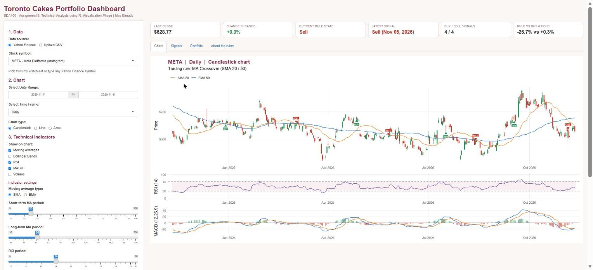
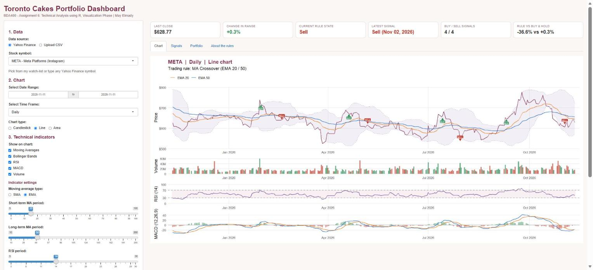
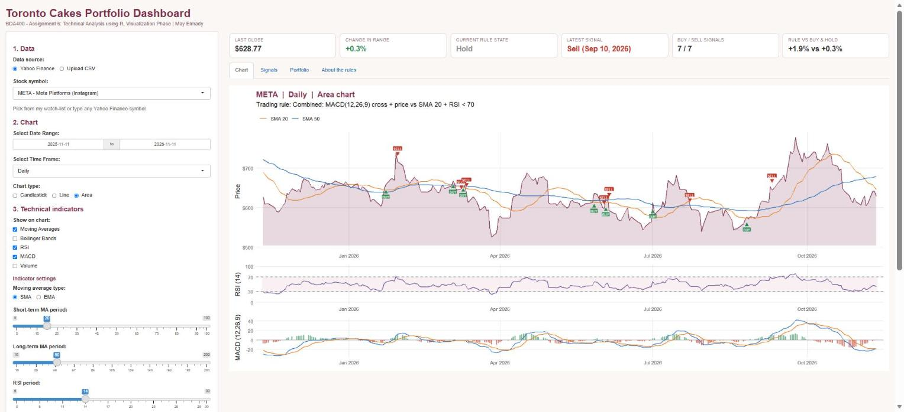
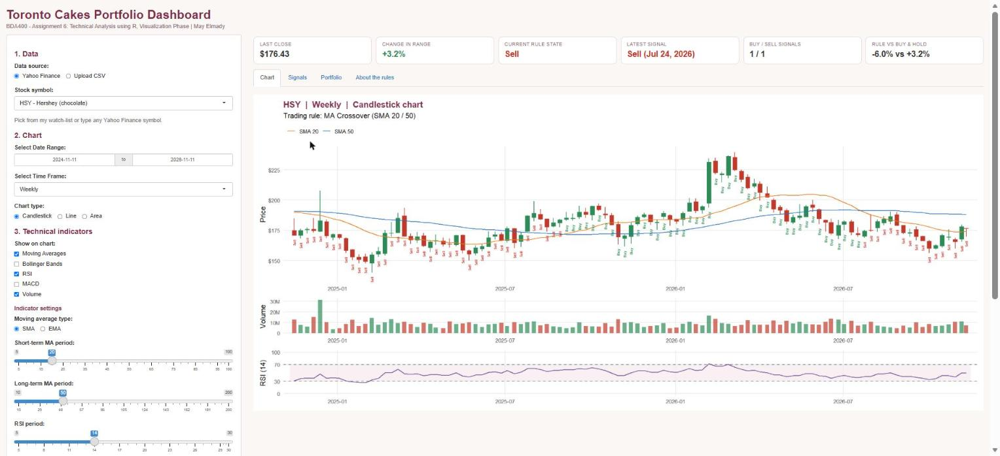
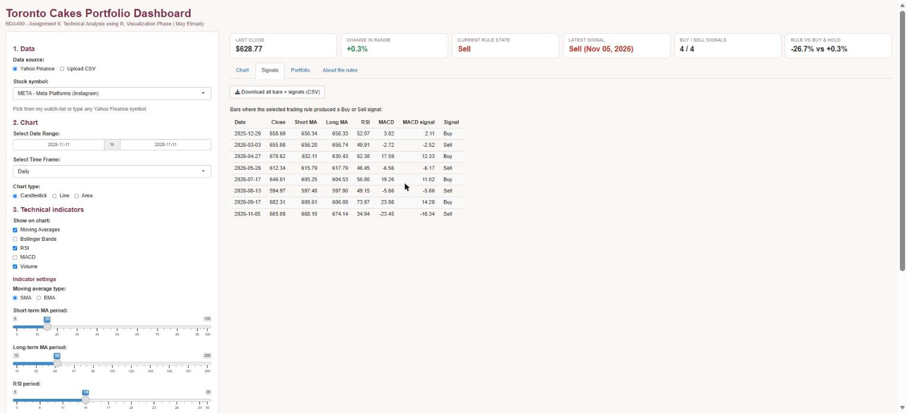
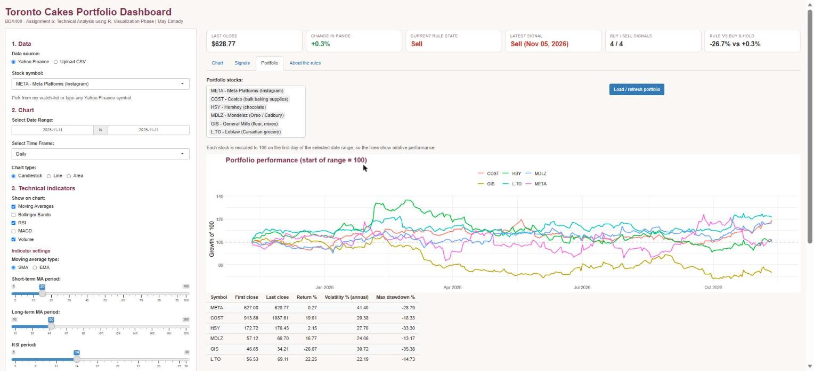

# Toronto Cakes Portfolio Dashboard

**Student:** May Elmady (Student ID 664430675)  
**Course:** BDA400 – Data Science Tools and Techniques  
**Assignment:** Assignment 6 – Technical Analysis using R, Visualization Phase (15%)  
**Repository:** https://github.com/may0elmady-ship-it/TechnicalAnalysis (this stage is in the `Assignment6` folder)

---

## Project description

I run **Toronto Cakes**, a custom cake business that takes its orders through Instagram. For this assignment I built an **R Shiny portfolio dashboard** that follows the companies my business depends on: **META** (Instagram's parent company), **COST** (Costco – bulk baking supplies), **HSY** (Hershey – chocolate), **MDLZ** (Mondelez – Oreo/Cadbury toppings), **GIS** (General Mills – flour and baking mixes) and **L.TO** (Loblaw – Canadian grocery). Any other Yahoo Finance symbol can also be typed in.

The dashboard:

- downloads historical prices from **Yahoo Finance** with `quantmod`, with a **CSV upload** as a second data source, and handles errors and missing data
- lets the user pick a **date range**, a **time frame** (Daily / Weekly / Monthly) and a **chart type** (Candlestick / Line / Area)
- overlays **Moving Averages (SMA/EMA)** and **Bollinger Bands** on the price chart, and adds **RSI**, **MACD** and **Volume** panels. Each indicator can be **switched on and off**, and all their settings can be changed
- applies one of four **trading rules** (MA Crossover, RSI Overbought/Oversold, MACD Signal Crossover, Combined) and **annotates the bars** with Buy / Sell signals, or with Buy / Sell / Hold on every bar
- shows summary cards, a signals table with CSV download, and a **Portfolio** tab that compares all watch-list stocks on one chart

## How this builds on Assignment 2

Assignment 2 (folder `Assignment2`) downloaded the Toronto Cakes Portfolio with `quantmod`, calculated statistics and 20/50-day moving averages, and drew static charts. This stage turns that work into an interactive Shiny dashboard: the same portfolio and moving averages, plus RSI, MACD, Bollinger Bands, trading rules and signal annotations.

## How to run

1. Install R and RStudio.
2. Open `app.R` in RStudio and click **Run App**. Any missing packages (`shiny`, `ggplot2`, `quantmod`, `patchwork`, `scales`) are installed the first time.

## Code organisation (`app.R`)

| Section in `app.R` | Assignment task |
|---|---|
| STEP 1 – Data Collection and Setup | Data source, packages, `getSymbols()` fetch, error handling, CSV fallback |
| STEP 2 – Visualizing Stock Data | Time-frame conversion, Line / Candlestick / Area charts |
| STEP 3 – Overlay Technical Indicators | MA, Bollinger Bands, RSI, MACD, Volume layers with on/off toggles |
| STEP 4 – Implement Trading Rules and Annotations | Buy / Sell / Hold rules, crossover detection, bar annotations |
| STEP 5 – Shiny UI and Server | Widgets, reactive logic, summary cards, signals table, portfolio tab |

## Screenshots

Screenshots of the app running with live Yahoo Finance data (November 2026):

**1. Candlestick chart, MA Crossover rule, RSI and MACD panels**

**2. Line chart with EMA 20/50, Bollinger Bands and Volume turned on**

**3. Area chart with the Combined trading rule**

**4. Weekly HSY chart with Buy / Sell / Hold written on every bar**

**5. Signals table**

**6. Portfolio tab comparing all six stocks**

---
*For learning purposes only – not investment advice.*
